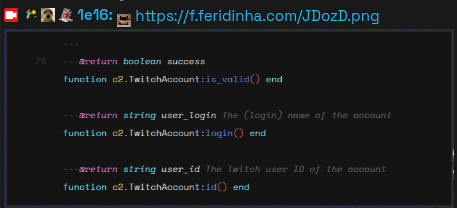

# Mediaware
A [Chatterino2](https://chatterino.com/) plugin to bring media related quality-of-life features.



> **warning:** This extension will have a feature for displaying any image someone sends in chat, as seen as above automatically. If you use the overlay feature to display on your streams, please don't use the feature without configuring the whitelist of trusted users to prevent unwanted media being shown. Allow only people you trust to use this feature while its enabled.

## Requirements
This plugin should run within any version or fork of chatterino that includes more complete support of its scripting API. If you're not sure wether a fork has or not support to this feature, use [`make_luals_meta.py`](https://github.com/Chatterino/chatterino2/blob/master/scripts/make_luals_meta.py) from Chatterino2's repository and compare it between the original codebase and your version/fork of it.

The following chat clients were tested and confirmed to work during the development of this plugin:

- [Chatterino2 (Nightly)](https://github.com/Chatterino/chatterino2/releases/tag/nightly-build)
- [Moltorino](https://moltorino.com/)
- [Leafyrino](https://leafyrino.leafyzito.dev/)

Lastly, the following permissions are required for this plugin to work currently:
```json
"permissions": [
    {
        // Network allows the plugin to make web requests.
        "type": "network"
    }
]
```

## Installation
Download this repository, and place it as a folder inside of the Plugins directory of Chatterino's AppData, or `~/.local/share/chatterino/Plugins`

```sh
git clone https://github.com/1e165/media-tools.git /path/to/chatterino/Plugins/media-tools
```

## Commands

`/img <url>`: Sends an image on the current chat based on the URL provided.

`/imgsize <scale>`: Defines the scale of any media sent.

## Planned features

- [ ] render images from messages automatically
- [ ] configurable web requests rate limiting
- [ ] stream mode to enable whitelisting automatic image requests

## Aknowledgements
Thank you for using my plugin, and for the developers of Chatterino, who made this convenient tool be possible for everyone!! If you appreciate the project, consider contributing to it by making pull requests or writing any issues you've had.
